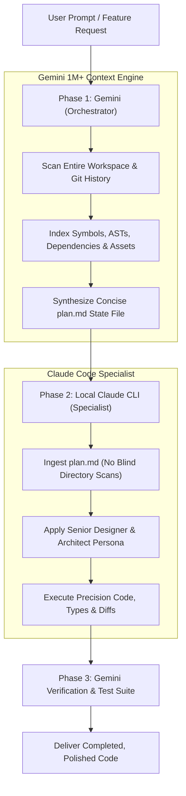

# Collaborate with Claude (`/collaborate-with-claude`)

A dual-model orchestration skill pairing **Gemini** (bulk contextual engine) with **Claude Code CLI** (precision design and architecture specialist), leveraging your active subscriptions to deliver maximum speed, optimal code quality, and minimum token consumption.

---

## Slash Command & Auto-Discovery

### Primary Slash Command
```text
/collaborate-with-claude [optional focus or target component/feature]
```

### Auto-Discovery Triggers & Keywords
This skill activates automatically when prompts include:
- `collaborate with claude`, `collaborate-with-claude`, `claude handoff`, `claude hand-off`
- `dual model workflow`, `gemini claude hybrid`, `multi-model orchestration`
- `send to claude`, `invoke claude`, `delegate to claude`, `claude specialist`
- `claude design review`, `claude architecture review`, `high precision design`
- `token saving handoff`, `plan.md handoff`, `run claude on this`

---

## High-Level Division of Labor



| Dimension | Gemini (Bulk Orchestrator) | Claude (Precision Specialist) |
| :--- | :--- | :--- |
| **Primary Strength** | Massive context (1M+ tokens), rapid repo-wide search, scaffolding | Nuanced aesthetic taste, typographic hierarchy, micro-UX ergonomics, deep logic refactoring |
| **Tokens Consumed** | Ingests entire repositories, configs, logs, and docs | Consumes ONLY compressed `plan.md` (saving ~80-95% tokens) |
| **Execution Surface** | Antigravity IDE / CLI agent environment | Local Claude Code CLI (`~/.local/bin/claude`) & Claude Projects |
| **Output Responsibility** | Produces `plan.md`, prepares diff targets, verifies execution | Modifies target files with architectural precision |

---

## Quick Start Runbook

1. **Verify Claude CLI**:
   Ensure `claude` is installed and authenticated:
   ```bash
   claude --version
   ```

2. **Trigger the Workflow**:
   Run `/collaborate-with-claude` in the chat or invoke:
   ```text
   /collaborate-with-claude Redesign the navigation bar and settings drawer with ergonomic typography and clean component boundaries.
   ```

3. **Gemini Execution (Phase 1)**:
   - Gemini traverses the workspace, indexes relevant files, maps imported design tokens and styles, and writes `plan.md`.

4. **Claude Hand-Off (Phase 2)**:
   - Run the automated hand-off script or Claude CLI:
     ```bash
     claude -p "Implement the design and architectural tasks in plan.md. Do not perform exploratory directory scans; edit only specified files." \
       --allowed-tools "Read,Edit,Write,Bash"
     ```

5. **Review & Verification (Phase 3)**:
   - Gemini inspects `git diff`, runs test suites / linters, and presents the summary to the user.

## Autonomous Zero-Copy Bridge (`claude-bridge.sh`)

You never need to manually copy text between Gemini and Claude. Gemini in Antigravity can execute the bridge tool (`claude-bridge.sh`) directly via `run_command`:

| User Intent in Chat | Autonomous Command Executed by Gemini |
| :--- | :--- |
| *"Pull Claude's plan and architecture"* | `~/.claude/skills/collaborate-with-claude/scripts/claude-bridge.sh pull-plan` |
| *"Ask Claude what to build next"* | `~/.claude/skills/collaborate-with-claude/scripts/claude-bridge.sh ask-next` |
| *"Send our audit feedback to Claude"* | `~/.claude/skills/collaborate-with-claude/scripts/claude-bridge.sh send-feedback "<audit text>"` |
| *"Ask Claude to review our git diff"* | `~/.claude/skills/collaborate-with-claude/scripts/claude-bridge.sh review-diff` |
| *"Have Claude implement its assigned tasks"* | `~/.claude/skills/collaborate-with-claude/scripts/claude-bridge.sh exec` |

---

## Detailed References

- Step-by-step SOP and token conservation rules: [instructions.md](./instructions.md)
- Standardized `plan.md` hand-off template: [plan-template.md](./plan-template.md)
- Agent persona and CLI configuration: [../agents/claude-specialist.md](../agents/claude-specialist.md)
- Autonomous zero-copy bridge script: [./scripts/claude-bridge.sh](./scripts/claude-bridge.sh)
- Direct CLI runner script: [./scripts/run-claude-hand-off.sh](./scripts/run-claude-hand-off.sh)
