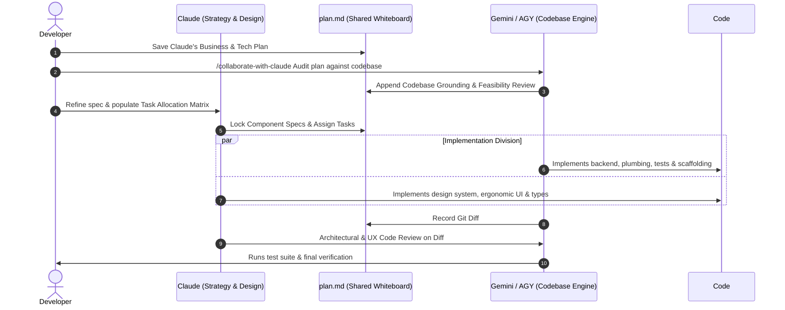

# Standard Operating Procedure (SOP): Gemini & Claude Collaboration Loop

This document defines the strict execution protocol for the dual-model hybrid workflow between **Gemini** (bulk orchestrator & context ingestor) and **local Claude CLI** (precision design, architecture, and logic specialist).

---

## The Core Philosophy: Asymmetric Advantage

Every model family has distinct architectural strengths:
- **Gemini**: Industry-leading context window (1M+ tokens), rapid file indexing, high-speed bulk AST parsing, and zero-cost exploratory workspace scans.
- **Claude (Sonnet / Opus)**: Industry-standard aesthetic nuance, typographic discipline, human-centric ergonomic UX instinct, defensive component separation, and surgical reasoning.

By pairing Gemini as the **Context Compressor** and Claude as the **Precision Craftsman**, you achieve elite code quality while conserving Claude subscription tokens and preventing rate limits.

---

## Phase 1: Gemini Ingestion & State File Generation

When a task begins, **Gemini must perform all exploratory, indexing, and synthesis work**. Gemini never delegates raw, undefined problems to Claude.

### Step 1.1: Bulk Repository Scanning
Gemini executes broad searches across the codebase:
- Scan project configuration (`package.json`, `tsconfig.json`, `tailwind.config.*`, CSS variables).
- Search symbol definitions, component trees, hooks, and backend routes.
- Trace existing design tokens, typography rules, color schemes, and spacing conventions.
- Identify the exact files that must be created or modified.

### Step 1.2: State Distillation & `plan.md` Creation
Gemini creates a single, token-dense hand-off file named `plan.md` in the current working directory (or target module directory). 

`plan.md` **MUST** adhere to the following schema:
1. **Executive Objective**: 1–2 sentences summarizing the user's intent.
2. **Explicit Target Files**: Exact file paths with line number hints (e.g. `src/components/Navbar.tsx:42-88`).
3. **Design & Ergonomics Directives**:
   - Typography scale & font tokens to use.
   - Spacing, padding, and layout constraints (e.g., 8px grid, responsive breakpoints).
   - Cognitive load reduction instructions (e.g., progressive disclosure, visual grouping).
4. **Architectural & Component Contracts**:
   - Props interfaces, state management boundaries, separation of concerns.
5. **Exact Code Snippets / Diff Hints**: Pre-computed snippets or logic constraints so Claude does not have to invent missing APIs.
6. **Acceptance Criteria**: Concrete checklist of required outcomes.

> [!IMPORTANT]
> Gemini must ensure `plan.md` is complete and self-contained before invoking Claude.

---

## Phase 2: Claude CLI Hand-Off & Execution

Once `plan.md` is written, the local Claude CLI is invoked to carry out the high-precision design and implementation.

### Step 2.1: Pre-flight Verification
Ensure the Claude CLI is accessible:
```bash
claude --version
```

### Step 2.2: Invoking Claude via Command Line

#### Option A: Headless Non-Interactive Run (Recommended for Automation)
Gemini or the developer triggers Claude in print mode (`-p`):

```bash
claude -p "You are Claude Specialist, a Senior Product Designer and Software Architect. Read plan.md and implement all specified changes in the designated target files. Do not scan any directory outside of plan.md. Adhere strictly to typography hierarchy, ergonomic UX, and component modularity." \
  --allowed-tools "Read,Edit,Write,Bash"
```

#### Option B: Dedicated Agent Mode
Invoke Claude with the pre-configured `claude-specialist` agent profile:

```bash
claude --agents '{
  "claude-specialist": {
    "description": "Senior Product Designer & UI/UX Architect",
    "prompt": "You are a Senior Product Designer and Software Architect. Focus on typographic hierarchy, ergonomic UX, and modular component structures. Rely exclusively on plan.md for context."
  }
}' --agent claude-specialist -p "Execute the tasks outlined in plan.md."
```

#### Option C: Interactive Review Session
When the user wants to co-edit or refine decisions interactively with Claude:

```bash
claude --append-system-prompt "You are executing plan.md prepared by Gemini. Do not perform full workspace scans; all target files and requirements are documented in plan.md."
```

### Step 2.3: Claude Project Knowledge Base Binding
If the task targets an existing Claude Project or shared design system:
- Pass the project context or token rules:
  ```bash
  claude --append-system-prompt "Targeting Claude Project: 'Design System & UX Guidelines'. Apply tokens defined in design-tokens.json." -p "Execute plan.md"
  ```
- Alternatively, link the project guidelines as `CLAUDE.md` in the workspace root.

---

## The Golden Rule: Token Conservation Protocol

> [!CAUTION]
> **STRICT TOKEN CONSERVATION RULE**:
> Claude is strictly forbidden from scanning raw directory trees from scratch.

### Prohibited Claude Behaviors:
- ❌ Running `find .`, `ls -laR`, `tree`, or recursive directory walks.
- ❌ Running unbounded search commands like `grep -rn` or `rg` across the entire workspace.
- ❌ Inspecting hundreds of files to discover project structure.
- ❌ Guessing where components or configurations live.

### Enforced Claude Behaviors:
- ✅ Claude must read **only** `plan.md` first.
- ✅ Claude must read **only** the explicit file paths listed in `plan.md`.
- ✅ Claude must use targeted edits (`Edit` or `Write`) on the specified files.
- ✅ Claude may run targeted validation commands (e.g. `npm run typecheck`, `npm test -- <test-file>`).

### Economic Rationale
A blind directory scan and exploratory code search in a modern repository can easily burn **25,000 to 80,000 tokens** per session before a single line of code is written. By letting Gemini perform the scan (utilizing Gemini's context window) and distilling it into a **1,500 token `plan.md`**, Claude's token consumption drops by **up to 95%**, preserving your Claude subscription rate limits for deep reasoning and design polish.

---

## Phase 3: Gemini Verification & Quality Loop

After Claude completes its execution run, control returns to Gemini to verify the output:

1. **Diff Inspection**:
   ```bash
   git diff --stat
   git diff
   ```
   Gemini verifies that only the intended files were modified and that no unexpected files were touched.

2. **Automated Verification**:
   Gemini runs linting, formatting, and tests:
   ```bash
   npm run lint || pnpm lint
   npm test || pnpm test
   ```

3. **Design & Ergonomics Audit**:
   Gemini verifies that Claude's work satisfies:
   - Proper typographic scaling and semantic HTML tags (`<h1>` to `<h6>`, `<nav>`, `<main>`, `<button>`).
   - Accessible color contrast and focus-visible states.
   - Clean prop interfaces and error boundary handling.

4. **Clean Up / Archive State**:
   Once verified, Gemini updates or archives `plan.md` (e.g., committing it or renaming it to `docs/plans/YYYY-MM-DD-<feature>.md` if persistence is desired).

---

---

## Phase 4: Bidirectional Collaboration & Dynamic Work Division

The workflow is not strictly one-way. When **Claude already holds the business analysis, UX design, and technical plans**, you can run a **Bidirectional Peer-Review & Division of Labor Loop**:



### The 4-Step Bidirectional Protocol

#### 1. Plan Ingestion & Gemini Codebase Audit
1. Claude's business analysis, UX wireframes, and technical plans are placed into `plan.md`.
2. In Antigravity (AGY), prompt:
   ```text
   /collaborate-with-claude Audit the business and technical plan in plan.md against our entire codebase. Check for architectural fit, existing reusable utilities, schema incompatibilities, and edge cases.
   ```
3. Gemini uses its massive context window to ground the plan in reality, appending a `## Codebase Grounding & Review` section to `plan.md`.

#### 2. Spec Refinement & Task Allocation Matrix
Claude digests Gemini's feedback and locks the formal specification. In `plan.md`, the models agree on who writes which layer:

| Task / Layer | Best-Fit Model | Rationale |
| :--- | :--- | :--- |
| **Component Contracts & Design Tokens** | **Claude** | Ergonomic UX, strict typing, typography scale |
| **Scaffolding, API Plumbing & DB Migrations** | **Gemini (AGY)** | Bulk code generation, speed, whole-repo context |
| **Complex Frontend UI & Interaction States** | **Claude** | Micro-interactions, WCAG AAA accessibility, cognitive flow |
| **Integration & Unit Test Suites** | **Gemini (AGY)** | Exhaustive test coverage, fast parallel mock generation |
| **Architectural Code Review** | **Claude** | High-precision audit of `git diff` against design specs |

#### 3. Execution According to Matrix
- When **Gemini** implements its assigned tasks: AGY writes the files and runs local build checks.
- When **Claude** implements its assigned tasks: Run `claude -p "Execute tasks assigned to Claude in plan.md"` (adhering to the token conservation rule).

#### 4. Cross-Model Code Review
Before committing:
1. Ask Claude to review Gemini's code:
   ```bash
   claude -p "Review the current git diff against the architectural specification in plan.md. Flag any design inconsistencies, UX regressions, or type flaws."
   ```
2. Ask Gemini to verify Claude's code:
   Run automated test suites and verify edge cases across the broader repository.

---

## Summary SOP Matrix

```text
[User Request / Claude Plan]
       │
       ▼
1. Gemini Ingestion & Audit
   ├── Ground plan against whole repository
   ├── Flag breaking changes & missing edge cases
   └── Fill Task Allocation Matrix in plan.md
       │
       ▼
2. Collaborative Implementation
   ├── Claude: Strict component specs & ergonomic UI
   └── Gemini: Scaffolding, plumbing, migrations & tests
       │
       ▼
3. Cross-Model Review
   ├── Claude reviews git diff against architectural specs
   └── Gemini runs test suites & verifies build integrity
```
