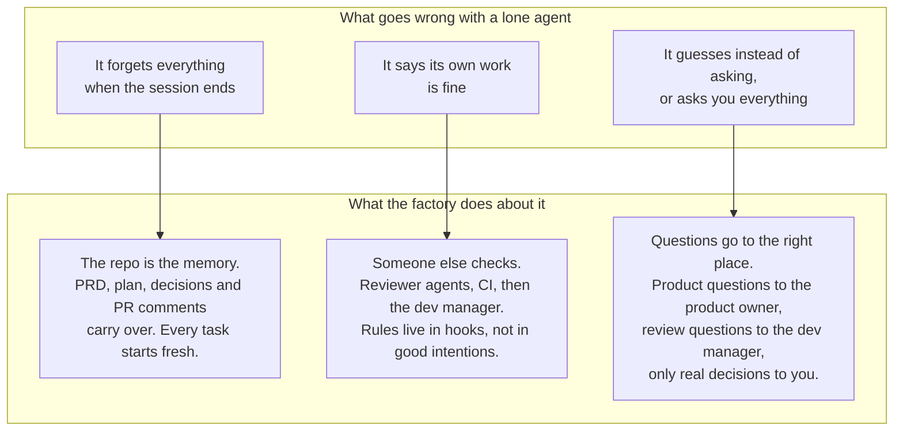
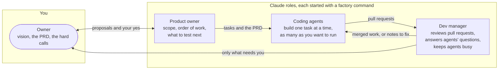
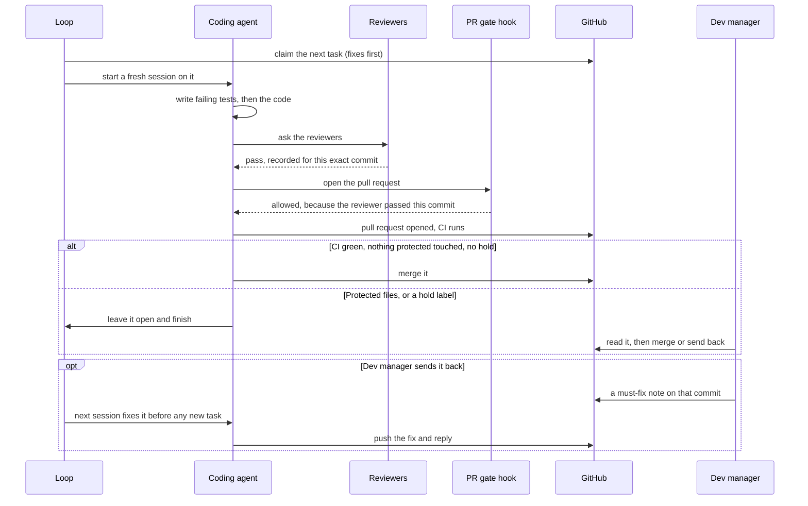
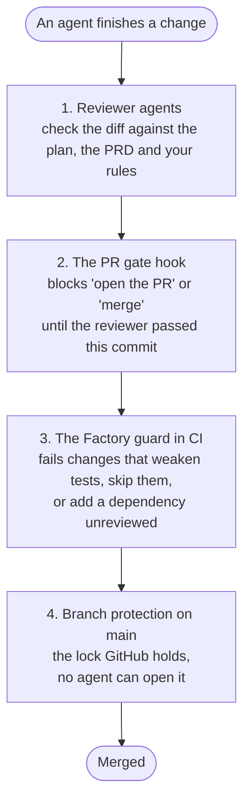
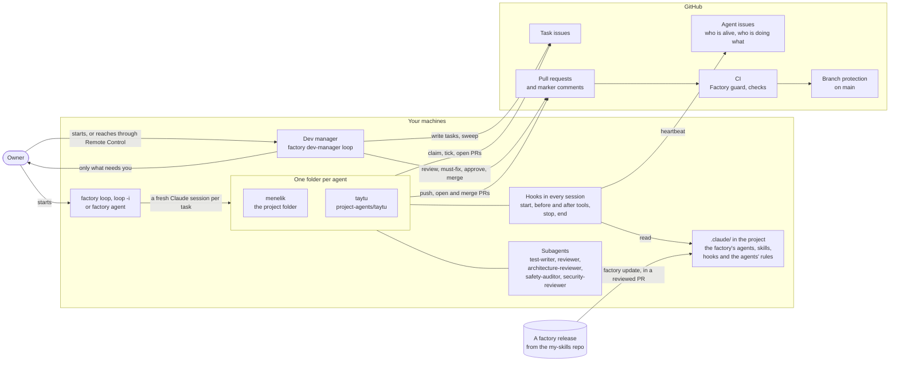
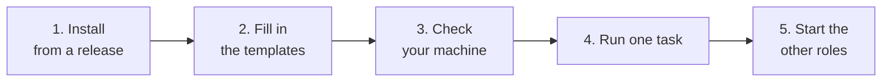

# software-factory

You write down what you want built. AI coding agents build it, one small task at a time, while other agents review
their work and a dev manager merges what is good. You hear about it only when a decision is really yours.

That is the whole idea. This page gives the overview and the quick start; the [wiki](#wiki) holds the details.

The scope of the factory is written down in [`software-factory/docs/PRD.md`](docs/PRD.md). It is the source of truth:
when this page and the PRD disagree, the PRD wins.

<br>
## The idea in one picture


Every box is a separate piece with one job. None of them marks its own homework.

<br>
## Why it is built this way

An AI agent is good at a small, clear job: "add this function, here is the test it must pass". It is bad at three
things that matter when a project gets bigger. It forgets between sessions. It is too kind to its own work. And it
doesn't know when to stop and ask. The factory is the process around the agent that covers those three gaps.



Two more choices follow from this:

- **Tasks are small.** One task, one pull request, one thing to review. Small things are easy to check and easy to undo.
- **The shared rules are separate from your project.** Agents, skills and hooks come from the factory. Your project
  only says what is special about it: its commands, its protected files, its ports. That is `.claude/factory.json`.

<br>
## Who does what

Four roles. Three are Claude sessions you start with one command each. The fourth is you.



| Role | Start it with | What it does |
|---|---|---|
| Coding agent | `factory loop -i` | Takes the next task, writes failing tests, builds it, asks the reviewers, opens one pull request |
| Dev manager | `factory dev-manager loop` | Reads each pull request, merges the good ones, sends the rest back with a clear note, answers questions |
| Product owner | `factory product-owner loop -i` | Keeps the PRD and the task list in order. Writes proposals; your yes comes as a reply |

The dev manager is a small program with no model of its own. It starts a short Claude session for each item, so a
quiet hour costs nothing.

<br>
## One task, start to finish



A few things worth noticing:

- **Tests come first.** The failing test says what "done" means before any code exists.
- **A reviewer's pass belongs to one commit.** Change the code and the pass no longer counts.
- **Fixes jump the queue.** A pull request sent back is picked up before new work starts.
- **A session is short.** When the task ends the session ends, and the next one starts clean from `main`.

<br>
## What stops bad work

Nothing relies on an agent behaving well. There are four layers, and each one assumes the one before it missed
something.



The agents' rules (their deny list and hooks) are passed only to the sessions the factory starts, read from `main`, so
an agent cannot loosen its own next run, and your own Claude sessions in the project are not bound by them.
Files that govern the agents themselves (the gate, the agents' rules, the agent definitions, `factory` and
`factory-loop.sh`) are on a protected list.
A change to them is never merged by the agent that wrote it. The dev manager or you merges it, except a change under
`.claude/` (the settings, the permissions, the agents' definitions): only you merge that.

<br>
## Where the machines and GitHub meet



Each agent gets its own folder, so two agents never trip over each other's files. Waiting costs no tokens: a loop
that has nothing to do sleeps instead of asking a model.

<br>
## Where things stand

The factory is in alpha. Every release so far is a pre-release, so you name one when you install (`factory update
v0.2.0-alpha.1`). `v0.2.0-alpha.1` is the first on Bun; the `v0.1.0` ones are the old Python factory
([Updating from releases](docs/wiki/updating.md#updating-from-releases)).

Not built yet:

- A custom screen. The Claude app, Remote Control and the plain-text commands (`factory status`, `factory prs`,
  `factory agents ls`, `factory follow`) are the interface.
- `factory bootstrap` runs on Linux only.
- One command to bump the pin for a whole team.
- A Slack or Mattermost bridge. It is an idea, not scheduled (PRD, sections 5 and 6).

<br>
## Wiki

<a id="wiki"></a>

The long parts of this guide are wiki pages in [`docs/wiki/`](docs/wiki). Each page opens on its own and has links to the page before and after it.

**Keep it up to date**

- [Updating the factory from releases](docs/wiki/updating.md): take a new release, and what an update changes.

**Run it**

- [The factory command](docs/wiki/commands.md): every `factory` subcommand and what it prints.
- [Agent loops](docs/wiki/agent-loops.md): loops, tasks, live agents, messages, `factory follow` and `factory autostart`.
- [Roles](docs/wiki/roles.md): the coding agent, the dev manager and the product owner.

**Review and merge**

- [Reviews and gates](docs/wiki/reviews-and-gates.md): which reviews a change needs and what an agent may merge.
- [The dev manager](docs/wiki/dev-manager.md): a manager pass, its queue and several managers at once.

**Machines**

- [CI and the build cache](docs/wiki/ci.md): GitHub's runners or your own Mac, and a shared build cache.
- [A sandboxed machine](docs/wiki/sandboxed-machine.md): `factory bootstrap` and security notes.

**Reference**

- [Settings and style guides](docs/wiki/settings.md): every `factory.json` setting and its default.
- [The files in the kit](docs/wiki/kit-files.md): what a project receives.
- [Projects that use the submodule](docs/wiki/submodule.md): the submodule, and how to move to releases.

<br>

<a id="set-up-a-project"></a>

## Quick start

You need a PRD first. The factory only builds what the PRD and the plan say. On the machine that runs the agents you
need git, bash, Bun, Claude Code and the GitHub CLI (`gh`, signed in). The factory is TypeScript run by Bun; install
Bun first with `curl -fsSL https://bun.sh/install | bash` (CI uses Bun 1.4 or newer). `factory bootstrap` installs it
for you on a sandboxed machine, and `factory doctor` checks it.



### 1. Install the factory in the project

1. **Download and check the release.** From the [releases page](https://github.com/deresegetachew/my-skills/releases)
   take `software-factory-<version>.tar.gz` and `SHA256SUMS` into one folder outside the project, run
   `sha256sum -c SHA256SUMS`, and unpack the archive there.
2. **Install it.** In the project's folder, in a terminal of your own (an agent session is refused), on a clean tree:

   ```bash
   bun --no-env-file <unpacked folder>/hooks/factory_release.ts update <version>
   ```

   `<version>` is the release you unpacked (a pre-release is only taken by name). The release client needs only Bun,
   so it can install into a project that has no factory yet. It checks the archive's checksum, writes the shared files (`.claude/hooks`, `.claude/ci`, the agents, the
   skills, the agents' rules `.claude/factory/settings.json`, `factory`, `factory-loop.sh`) as real files, writes the pin `.claude/factory/release.json`
   and, on a first install, adds the templates you fill in, never over a file that exists. It commits nothing.
   [What it does, step by step](docs/wiki/updating.md#updating-from-releases).

### 2. Fill in the templates and merge

- `.claude/factory.json`: commands, paths, protected files, ports. `factory settings` is the guided way
  ([settings](docs/wiki/settings.md#factoryjson-settings)), or ask Claude to "set up the software factory" (the `software-factory` skill
  walks through it).
- `CLAUDE.md`, from `CLAUDE.factory.md`: the project's rules.
- The tasks: `docs/build-plan.md`, or [GitHub issues](docs/wiki/agent-loops.md#issues-mode) (`factory issues setup` makes the labels once).
- `.github/workflows/ci.yml`: your stack's commands.
- For a project with no PRD scaffold yet, `factory init` adds the role folders, the labels, the owner queue, a starter
  PRD and the PRD-change PR template, and adds nothing twice ([From an idea to a first milestone](docs/wiki/roles.md#from-an-idea-to-a-first-milestone)).

Commit it on a branch, open a PR and merge it. Then set up [branch protection](docs/wiki/reviews-and-gates.md#branch-protection-the-real-lock) on
main.

### 3. Set up your machine, once

```bash
./factory install-shim              # puts a `factory` command in ~/.local/bin
factory doctor                      # what's missing on this machine, and how to fix it
```

### 4. Run the first task

- `factory next` shows the job the factory would hand out next. It claims nothing; its last line shows the command that
  does.
- `factory loop -i` starts a coding agent: a fresh session per task that you can watch and type into. `factory loop` is
  the unattended version. [Which one](docs/wiki/agent-loops.md#three-ways-to-run-an-agent).
- The agent writes failing tests, builds, asks the reviewers and opens one pull request with `Closes #<n>`.
  [How a task is picked](docs/wiki/agent-loops.md#tasks).

### 5. Start the other roles

Every role is a factory command ([Roles](docs/wiki/roles.md#roles)). The table above lists them. `factory loop -i` in a terminal with no
role asks which role and which name. From the Claude app, reach a running session through Remote Control; there is no
web console.

### Where to read next

- [The `factory` command](docs/wiki/commands.md#the-factory-command): every command, in one table.
- [factory.json settings](docs/wiki/settings.md#factoryjson-settings): every setting, with its default.
- [`docs/PRD.md`](docs/PRD.md): what is in scope, what is decided, and what is later.

<br>
## Where things live

The factory's code sits in plain folders of `software-factory/` (#112): `hooks/`, `ci/`, `factory` and `factory-loop.sh`. `kit/` holds only what a project is given.

```
software-factory/
  factory                       the command line
  factory-loop.sh               the loop behind `factory loop`
  install.sh                    puts the factory into a project (links, or copies)
  VERSION                       the release number (a `vX.Y.Z` tag must match it)
  hooks/                        every hook and every `factory_*.ts` command, next_task.ts, pr-gate.ts, check.ts ...
  ci/                           `factory ci`: ci.sh, the compose files, the runner image, entrypoint.sh
  tests/                        the tests (run with tools/run_tests.ts at the repo root)
  docs/                         reference pages (PRD.md, messages.md, manager-handover.md) and the wiki
    wiki/                       the long parts of this guide, one page per topic (links in the Wiki list above)
      updating.md               updating from releases
      commands.md               the `factory` command
      agent-loops.md            loops, tasks, live agents, messages, `factory follow`, `factory autostart`
      roles.md                  coding agent, dev manager, product owner
      reviews-and-gates.md      reviews and the PR gate
      dev-manager.md            the dev manager
      ci.md                     CI and the shared build cache
      sandboxed-machine.md      `factory bootstrap` and security notes
      settings.md               style guides and every `factory.json` setting
      kit-files.md              the files in the kit
      submodule.md              projects that use the submodule
  kit/                          what a project is given:
    .claude/agents, skills, manager/, factory/settings.json   Claude Code reads agents and skills from .claude/; the factory passes the agents' rules (#258)
    .claude/factory.json, factory/notes/, CLAUDE.factory.md, docs/, .github/, .gitignore     templates, copied once
```

`kit/` holds no factory code and no symlinks. The forwarders that stood at the old `kit/` paths during the move were
removed once every project had left them (#176).

**What a project sees stays the same.** Claude Code reads agents and skills from the project's `.claude/`, and the
factory passes the agents' rules when it starts an agent (#258), so the project has `.claude/hooks/`, `.claude/ci/`,
`.claude/agents/`, `.claude/skills/`, `.claude/factory/settings.json`, `factory` and `factory-loop.sh` at those paths.
Only where they come from differs:

| The project takes the factory as | Those paths are | They change by |
|---|---|---|
| A release (`.claude/factory/release.json` exists) | real files, committed | `factory update` or `factory rollback`, then a reviewed pull request |
| The submodule | relative symlinks to `vendor/my-skills/software-factory/hooks/...`, `.../ci/...`, `.../factory` | the pin of `vendor/my-skills`, then `factory update` |

What stays the project's own in every case: `.claude/factory.json`, `.claude/factory/notes/`, `.claude/factory/lessons.md`,
`CLAUDE.md`, its docs, its CI workflow, and (on releases) the pin file.

**A project on the submodule** moves to releases with `factory migrate-to-release <tag>`, in one reviewed pull request
([Projects that use the submodule](docs/wiki/submodule.md#moving-a-project-from-the-submodule-to-releases)). Until
then, `factory update --layout new` (or `bash vendor/my-skills/software-factory/install.sh . --link` after moving the
submodule) re-points any link it still has into the old `kit/` paths to the factory's own folders. Check with
`ls -l .claude/hooks` (it shows `.../software-factory/hooks/...`) and `factory doctor`, then commit the changed links
in a pull request; the owner merges it. `--layout new` and `auto` are still accepted and change nothing; `--layout old`
is refused with `[layout_removed]`.

**The nestjs skills are not in the release.** `nestjs-best-practices` and `nestjs-clean-code-ddd-hexagonal` are
top-level folders of my-skills, outside `software-factory/`, and a release ships only `software-factory/`. A project
that uses them (remanual) keeps `vendor/my-skills` as a submodule after it moves to releases, for these things only:
its `.claude/skills/nestjs-*` links, the `check` command in `.claude/factory.json` that runs
`python3 vendor/my-skills/nestjs-clean-code-ddd-hexagonal/scripts/check_structure.py` (a script of that skill, not
of the factory), and `submodules: true` on the
`actions/checkout` steps in its `ci.yml`. Keep them; the factory itself (hooks, CI, agents, `factory`) comes from the
release. A project that does not use the nestjs skills drops the submodule entirely.

**The move is done** (#112, #113): the code is out of `kit/` and `.claude/`, releases exist (pre-releases so far;
cutting one stays the owner's call), Remanual, the first project, is on releases (its PR 440), and the `kit/`
forwarders and `--layout old` are gone (#176).
