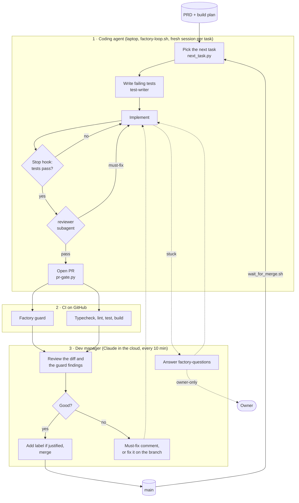

# software-factory

Turn a repo into a software factory: a coding agent builds from a PRD and a build plan in a loop, and a dev
manager Claude session reviews, merges and keeps it busy. See `SKILL.md` for how it works and how to set it
up, and `DEV-MANAGER.md` for the dev manager's playbook.

## How it works



The coding agent never merges anything protected and never grades its own tests: the reviewer subagent checks
the diff before the PR, CI checks what the agent can't edit around, and the dev manager reads every finding
before it labels or merges. Only owner-only decisions reach a person.

### The Factory guard

`kit/.claude/hooks/factory_guard.py` runs in CI on every pull request. It compares the branch with main and
fails when the change could make the build look better than it is:

| Finding | Passes with |
|---|---|
| An existing test deleted, or an assertion or test case removed or rewritten | `tests-reviewed` label |
| A test softened in a commit after implementation started | `tests-reviewed` label |
| An existing golden or expected output changed | `tests-reviewed` label |
| A new `.skip`, `.only`, `xit`, `test.todo` | `tests-reviewed` label |
| A new dependency in a package manifest | `deps-reviewed` label |
| Two decision files with the same number | never: renumber |
| A task branch ticking another task in the plan | never |
| A workflow using `pull_request_target` | never |

Large PRs get a warning, not a failure. The labels belong to the dev manager, who adds one only after reading
the change. A label change re-runs only the guard job.

```
software-factory/
  SKILL.md          set up a project (mode 1) or act as dev manager (mode 2)
  DEV-MANAGER.md    the dev manager playbook: ticks, reviews, merges, keeping the coding agent busy
  install.sh        copies kit/ into a project without overwriting
  kit/
    CLAUDE.factory.md            template for the project's CLAUDE.md
    .claude/factory.json         paths, commands and protected files for this project
    .claude/settings.json        permissions and the two hooks
    .claude/hooks/check.py       Stop hook: typecheck and tests must pass before a turn ends
    .claude/hooks/pr-gate.py     PreToolUse hook: reviewer pass, green CI, no protected files, or no merge;
                                 refuses ticked or blocked tasks and more than maxOpenPRs at once
    .claude/hooks/factory_guard.py   CI guard: tests/golden edits, skips, new deps, decision numbers, task ticks
    .claude/hooks/next_task.py   picks the next task from the plan on main (--claim: one no other loop holds)
    .claude/hooks/factory_claims.py  lock file for several loops: a checkout each, one task each
    .claude/hooks/wait_for_merge.sh  waits on a PR without spending tokens
    factory-loop.sh              runs one fresh Claude session per task; start it again for a second loop
    .claude/agents/              reviewer, test-writer, safety-auditor, security-reviewer
    .claude/skills/              next-task, design-check, eval
    docs/                        build-plan, blocked list and decision templates
    .github/                     CI workflow and CODEOWNERS templates
```

Quick start in a project that has a PRD:

```bash
bash ~/path/to/my-skills/software-factory/install.sh .
# fill in .claude/factory.json, CLAUDE.md and docs/build-plan.md (or ask Claude: "set up the software factory")
./factory-loop.sh        # or: claude, then /loop /next-task all
./factory-loop.sh        # again, in a second terminal, for a second loop on other tasks
```

Then, in a Claude session with the repo attached (cloud, so it runs with the laptop closed): "be the dev
manager for this repo".

The hooks need Python 3 and the GitHub CLI (`gh`) on the coding agent's machine.
